# TOMAS-JAX vs PyCHAM: an independent check of the AAAR tutorial box model

*2026-10-14; S1 and S2 re-run 2026-10-15 with the PPM bin transfer. For Ali and Shantanu. Harness and reproduction: `benchmarks/pycham/`
([README](../../benchmarks/pycham/README.md)); per-case details in
`benchmarks/pycham/cases/<case>/README.md`.*

## Purpose and verdict

The AAAR tutorial box model (`tomas_jax.box`: MCM limonene chemistry in JAX, TUV-x
photolysis, c*-class SOA partitioning through vbs-jax, TOMAS sectional aerosol) was run
side by side with PyCHAM, an independent chamber model, on the same mechanism, the same
photolysis and, where possible, the same particle inputs. The aim is an honest check:
every difference is reported as it came out and explained, and nothing in TOMAS-JAX was
tuned to PyCHAM. Where the two models cannot be made identical, the difference is listed
with its cause and its measured effect. Attribution runs (one difference removed at a
time) are numerical experiments done in benchmark code; they never change the model.

| Process | Verdict | Main residual and its cause |
|---|---|---|
| Gas chemistry (G2) | **Same ODE system.** All 2135 rate constants agree to 4e-16. At the preset 300 s coupling the median \|NMB\| over 391 species is 1.7e-3 (max 3 %); at 60 s it is 3e-4, and with tight solver tolerances and the same water vapour formula 5e-7. | RO2+RO2 products in the first 20 min (RO2 frozen at 0 for the first interval). |
| Photolysis and day/night (G3) | **Agree once the coupling is short.** 900 s preset: median \|NMB\| 10 % over 361 species, HNO3 −9 %, NO −11 % by day. 60 s: 0.6 %, every species within 2.6 % at all times. All differences removed: 1.5e-6. | How NO2 is "held": TOMAS-JAX resets it after each interval, PyCHAM fixes it inside the solver. Plus J and RO2 frozen for 900 s. |
| Condensation / evaporation (S1) | **Mass agrees within ~1 % at 12 h; the size distribution differs by the Kelvin term and transfer coefficient only; early uptake is faster.** c* = 1 SOA +0.7 % at 12 h (max +4.1 % at 1–3 h), c* = 100 −0.3 %. Number-mean dry diameter +2.3 % and GSD −3.2 % at 12 h, the same at 40 and 160 bins (TOMAS-JAX moves by ≤ 0.1 % with resolution). With Kelvin off in both and PyCHAM's transfer coefficient in TOMAS-JAX: −0.2 to +0.1 % in diameter and −0.4 to +0.1 % in GSD at 40–160 bins. | vbs-jax's transfer coefficient (up to 1.5× PyCHAM's and above the kinetic limit) and the Kelvin term. Until 2026-10-15 TOMAS-JAX moved growing particles with MNFIX, which spread the distribution (diameter −12.6 % at 40 bins); it now uses a PPM remap. |
| SOA partitioning with chemistry (S2) | **Total SOA within 1–4.2 % after 1 h (+1.1 % at 6 h), +13 % at 30 min.** Per c* class within ~11 %. | Operator split and transfer rate early on; per-species apportionment inside a class off by up to 4×. The volatility itself is not tested (identical c* by construction). |

What this means for the tutorial: the gas-phase chemistry and the partitioning
numerics are sound. Three TOMAS-JAX behaviours deserve a decision (they are model
choices, not bugs): the coupling interval (300/900 s) and the NO2 reset convention in
Level 3; the vbs-jax transfer coefficient; and the within-class species tracker. A fourth,
the size-distribution spreading at 40 bins, was fixed on 2026-10-15 (SOA growth now moves
particles with a PPM remap; S1 and S2 below were re-run with it). Separately, the large
NOx-sink feedback seen in Level 2 SOA comes from the Li et al. (2016) placeholder c*
(A8): with PyCHAM's own vapour pressures it disappears.

## Models and versions

| | TOMAS-JAX (ours) | PyCHAM (reference) |
|---|---|---|
| Version | `tomas-jax` branch `feat/aaar-tutorial`, commit `8753736` plus the opt-in `driver.run(observer=...)` hook (default runs and `RunResult` unchanged); S1 and S2 re-run 2026-10-15 on branch `feat/aaar-tutorial-ppm-soa` (PPM bin transfer for SOA and nitrate; gas chemistry unchanged); vbs-jax `4a67f16`, tuvx-jax `e5d9032`, JAX 0.11.2, diffrax 0.7.2 | v5.8.0, commit `7880d81`, with `single_seed_dry_fix.patch`; UManSysProp `f6d8645`; Python 3.10, exact environment in `benchmarks/pycham/requirements-lock.txt` |
| Gas solver | diffrax Kvaerno3, rtol 1e-3, atol 1e4 molec cm⁻³; rate constants, J (interval midpoint) and the RO2 sum frozen per coupling interval (300 s Level 1–2, 900 s Level 3) | scipy BDF, rtol 1e-4, atol 1e-3; rates, J and RO2 refreshed every `update_step` (60 s here) |
| Gas–aerosol coupling | operator split per coupling interval | one ODE system for gas and particles |
| Aerosol | TOMAS two-moment fixed sectional bins; SOA and nitrate move between bins by a PPM remap, MNFIX elsewhere | moving-centre bins |
| Partitioning | vbs-jax (Zaveri et al. 2014), Raoult by **mass** fraction over the organic phase, Kelvin σ = 0.025 N m⁻¹ | Raoult by **mole** fraction, Kelvin σ = 0.072 N m⁻¹ (also on water), Fuchs–Sutugin (Jacobson) |
| Water | ammonium-bisulfate ratio for sulfate and all organics, no Kelvin term (A9) | ideal solution with per-component dissociation constants, with Kelvin term |

## What was matched, and how

- **Mechanism.** PyCHAM reads a copy of the tutorial `.eqn` in which only `<34>
  N2O5 = NA + NA` has rate `0.0` (TOMAS-JAX replaces it in code by γ uptake, with γ = 0
  in these cases). The SMILES of D9/D9PROD (not in PyCHAM's MCM xml) were added.
- **Rate constants.** PyCHAM evaluates the generic MCM rate expressions from the same
  KPP `constants_mcm.f90` that TOMAS-JAX uses. PyCHAM's generated `rate_coeffs.py` was
  evaluated outside a run: all 2135 rate coefficients equal ours to 4e-16 (G2) and
  6.7e-16 (G3, five times including the sunset and sunrise intervals) at the same T, M,
  H2O, RO2 and J. The RO2 pools are identical (146 members).
- **Photolysis.** PyCHAM's built-in J table is not used (it differs from MCM v3.3.1,
  see "PyCHAM findings"). Every PyCHAM run reads `light_status = J.xlsx` with **our**
  28 J values on our coupling grid, i.e. the value TOMAS-JAX freezes for each interval
  (the J at the interval midpoint). PyCHAM applies the file as a step function from each
  interval start, so both models see identical photolysis. Checked: the J files equal
  our recorded J to 5e-16, rate constants agree including the J terms, and the daytime
  Leighton ratio is 1.188 (PyCHAM) vs 1.195 (TOMAS-JAX) in G3.
- **Environment.** Same T, P = 101325 Pa (PyCHAM's default is 9.8e4), RH, initial
  mixing ratios. Air number density agrees to 2e-16. PyCHAM has no walls, no dilution
  and no coagulation; `res_file_name` is absolute and PyCHAM runs from its repository
  root (otherwise its MCM photolysis is silently zero).
- **Particles (S1, S2).** PyCHAM gets the TOMAS-JAX size grid (manual bin bounds) and,
  bin by bin, the same initial number and dry mass (checked to 1e-9 and 1e-6); the same
  vapour pressure for every condensable species (converted from our c* with PyCHAM's own
  molar mass); dissociation constants that make its ideal-solution water equal ours
  component by component when its Kelvin factor is 1; and one effective dry density that
  gives the same wet volume at t = 0. Sulfate and water are excluded from PyCHAM's
  absorbing phase, as in TOMAS-JAX.
- **Numerics.** PyCHAM's update step is 60 s. TOMAS-JAX is run at the preset coupling
  and at 60 s to separate the operator-split effect from everything else.

Each case also runs the attribution experiments listed in its section, and records
every remaining difference with what, why and effect (`summary.json` → `mismatches` for
S1 and S2; the tables in the case READMEs for G2 and G3).

## Cases

| Case | Preset | Duration | Processes in both models | Preset processes switched off (not tested) |
|---|---|---|---|---|
| G2 | `level2_limonene_soa` | 6 h, constant light | chemistry | SOA partitioning, H2SO4 condensation, coagulation (seed is a spectator; gas phase checked bit-identical without it) |
| G3 | `level3_day_night` | 24 h from 12:00 EDT, Buffalo, 1 July | chemistry, NO2 held at 1 ppb | SOA partitioning, H2SO4 condensation, coagulation, N2O5 uptake (preset γ = 0.02) |
| S1 | `level1_volatility` | 12 h | SOA partitioning of one surrogate (c* = 1 and 100 µg m⁻³) | coagulation |
| S2 | `level2_limonene_soa` | 6 h | chemistry, H2SO4 condensation, SOA partitioning | coagulation |

Nucleation is off in every preset and every case. Statistics: a (time, species) point
counts when PyCHAM is ≥ 1e-5 ppb; t = 0 is excluded; NMB = Σ(ours − PyCHAM)/Σ PyCHAM;
"max deviation" = max |ours/PyCHAM − 1| over time. Bookkeeping species (SA, NA, NA_HET,
PROD, H2O) and held species (G3: NO2) are excluded from the all-species statistics.

---

## Case G2: gas phase, Level 2 conditions

| Setting | Value |
|---|---|
| Gases [ppb] | limonene 10, O3 40, NO 0.5, NO2 2, SO2 1, CO 120, CH4 1900, H2 500 |
| Environment | 298.15 K, 101325 Pa, RH 0.5, 6 h |
| Light | constant: TUV-x at SZA 30° scaled to J_NO2 = 5e-3 s⁻¹, our 28 J values prescribed to PyCHAM |
| TOMAS-JAX runs | coupling 300 s (preset), 60 s; attribution: 60 s at rtol 1e-5/atol 1, then + PyCHAM's water vapour |
| PyCHAM runs | default (rtol 1e-4), rtol 1e-6 |

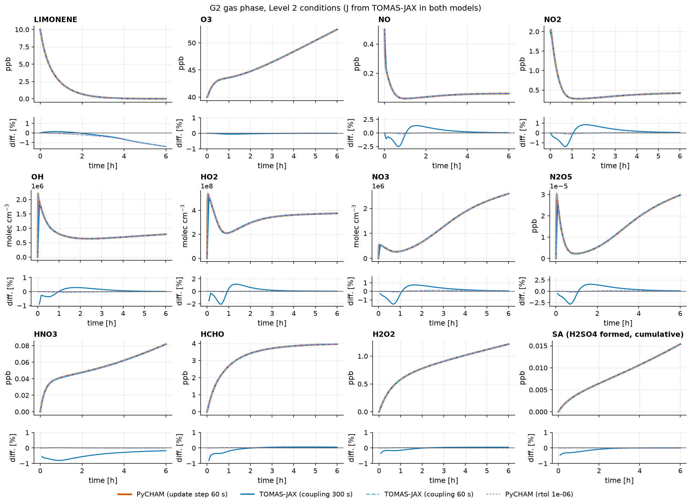

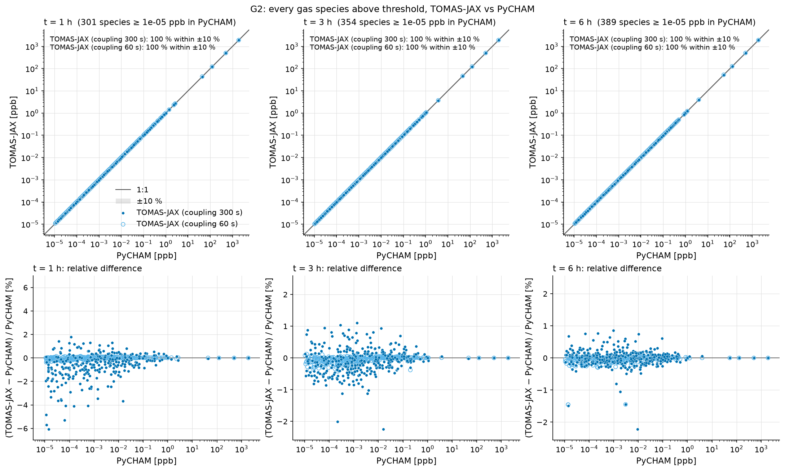

| All 391 species | coupling 300 s (preset) | coupling 60 s |
|---|---|---|
| median \|NMB\| | 1.7e-3 | 3.1e-4 |
| 95th percentile \|NMB\| | 6.8e-3 | 2.2e-3 |
| max \|NMB\| | 3.0 % (LIMAOH) | 0.35 % |
| species with max deviation ≤ 10 % over 6 h | 87.5 % | 100 % (max 1.5 %) |
| species within ±10 % at 1, 3 and 6 h | 100 % each | 100 % each |

| Key species (NMB / max deviation) | 300 s | 60 s |
|---|---|---|
| LIMONENE | +0.07 % / 1.4 % | −0.07 % / 1.4 % |
| O3 | −0.02 % / 0.06 % | 0.00 % / 0.001 % |
| NO | 0.00 % / 2.5 % | +0.01 % / 0.17 % |
| NO2 | +0.02 % / 1.4 % | 0.00 % / 0.12 % |
| OH / HO2 | 0.00 % / 0.9 %; +0.05 % / 2.1 % | −0.02 % / 0.05 %; 0.00 % / 0.08 % |
| HNO3 | −0.4 % / 0.8 % | 0.00 % / 0.02 % |
| PAN | +0.15 % / 3.3 % | −0.01 % / 0.03 % |
| C822PAN (top particle-phase species of the full Level 2 run) | +0.2 % / 2.7 % | −0.03 % / 0.11 % |

At 6 h the two models agree to three significant figures for every key species.

**Differences, explained.** 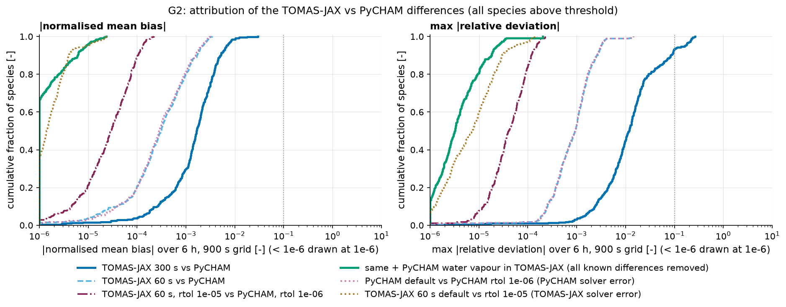

| Comparison (900 s grid) | median \|NMB\| | max \|NMB\| | max deviation |
|---|---|---|---|
| ours 300 s vs PyCHAM | 1.6e-3 | 3.0e-2 | 26 % |
| ours 60 s vs PyCHAM | 3.1e-4 | 3.5e-3 | 1.5 % |
| PyCHAM default vs PyCHAM rtol 1e-6 (PyCHAM's own solver error) | 2.9e-4 | 3.3e-3 | 1.5 % |
| ours default vs ours rtol 1e-5 (our solver error) | 1.4e-6 | 2.5e-5 | 0.015 % |
| ours 60 s rtol 1e-5 vs PyCHAM rtol 1e-6 | 2.9e-5 | 2.2e-4 | 0.023 % |
| same, plus PyCHAM's Hyland–Wexler water vapour in ours | 5.5e-7 | 2.3e-5 | 0.020 % |

- *Numerical, coupling interval.* TOMAS-JAX freezes the RO2 sum for each interval at its
  value at the interval start. In the first 300 s that is 0, so RO2+RO2 products
  (LIMAOH, CH3OH, C924OH, …) are exactly 0 at 5 min. Every species that deviates by
  more than 10 % does so only in the first 20 min; the deviation is ≤ 26 % at 15 min and
  ≤ 6 % after 1 h. At 60 s coupling (= PyCHAM's update step) it disappears.
- *Numerical, solvers.* The 60 s residual (e.g. limonene −1.4 % at 6 h, when it is
  0.003 ppb after eight e-folds) is PyCHAM's BDF error at its default rtol 1e-4:
  PyCHAM at rtol 1e-6 gives 0.0029966 ppb, ours 0.0029965.
- *Physical constant.* Buck (ours) vs Hyland–Wexler (PyCHAM) water vapour differ by
  2.2e-4, which moves H2O-dependent rate constants by the same amount.

With every difference removed the two models solve the same ODE system to solver
precision. Runtime: PyCHAM 16 s; TOMAS-JAX 4.8 s at 300 s, 19 s at 60 s coupling.
More figures: [PAN species](figures/pycham/g2_pan_species.png),
[top particle-phase species of the full Level 2 run](figures/pycham/g2_particle_relevant.png),
[distribution of log10 ratios](figures/pycham/g2_ratio_cdf.png).

---

## Case G3: gas phase, Level 3 day/night

| Setting | Value |
|---|---|
| Environment | 293.15 K, RH 0.6, 24 h from 2026-07-01 12:00 EDT, Buffalo (42.89 N, 78.88 W); sunset 20:53 EDT (t = 8.88 h), sunrise 05:47 (t = 17.78 h) |
| Photolysis | TUV-x in TOMAS-JAX; PyCHAM reads our J on a 60 s grid (reference) or on the 900 s grid |
| Held species | NO2 = 1 ppb (A14): TOMAS-JAX `hold_constant`, PyCHAM `const_comp` |
| TOMAS-JAX runs | 900 s (preset), 60 s; attribution: 900 s with NO2 held inside the solver, 60 s tight, + PyCHAM water, + NO2 held inside the solver |
| PyCHAM runs | J every 60 s (reference), J every 900 s, J every 60 s at rtol 1e-6 |

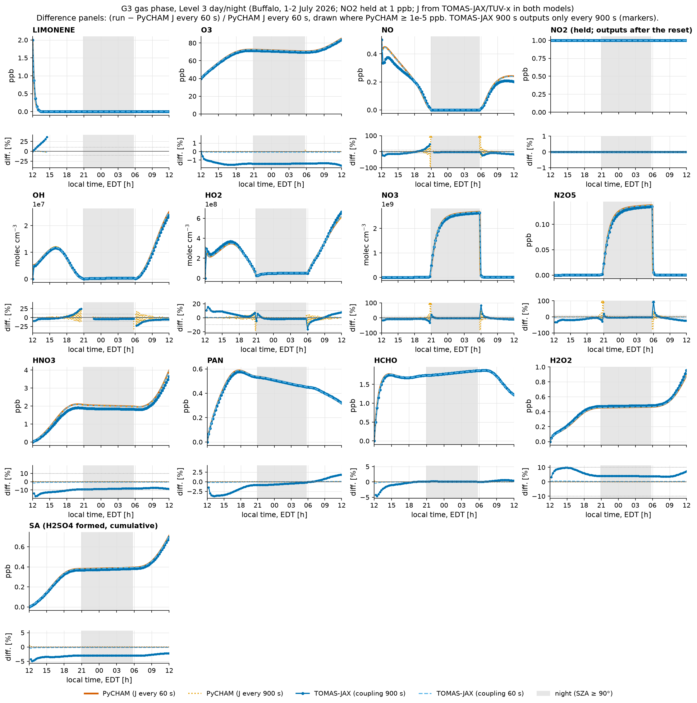

| 361 species (NO2 excluded) | coupling 900 s (preset) | coupling 60 s |
|---|---|---|
| median \|NMB\| | 0.104 | 5.7e-3 |
| 95th percentile \|NMB\| | 0.29 | 0.019 |
| species with \|NMB\| ≤ 10 % | 49 % | 100 % |
| species with max deviation ≤ 10 % over 24 h | 6 % | 100 % (max 2.6 %) |
| within ±10 % at 21:00 / 00:00 / 12:00 | 53 / 56 / 38 % | 100 / 100 / 100 % |

| Key species | NMB 900 s | max deviation 900 s | NMB 60 s |
|---|---|---|---|
| O3 | −1.4 % | 2 % | −0.1 % |
| NO (day) | −10.6 % | 46 % | −0.5 % |
| OH / HO2 | −3.8 % / +4.3 % | 24 % / 16 % | −0.1 % / +0.2 % |
| NO3 / N2O5 | −1.6 % / −2.8 % | 84 % / 120 % (06:00) | −0.1 % / −0.2 % |
| HNO3 | −8.7 % | 17 % | −0.6 % |
| H2O2 | +4.9 % | 10 % | +0.3 % |
| cumulative H2SO4 formed (SA) | −2.9 % | 5 % | −0.2 % |
| LIMALNO3 (top particle-phase species of the full Level 3 run) | +1.6 % (night +27.5 %) | 32 % | +0.0 % |

**Differences, explained.** 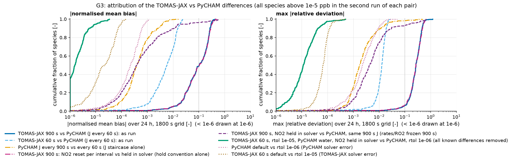

1. *Held-species convention (modelling choice; dominant at 900 s).* TOMAS-JAX resets
   NO2 to 1 ppb after every coupling interval and lets it evolve freely inside the
   interval; PyCHAM sets d[NO2]/dt = 0 inside the ODE. Inside a 900 s daylight interval
   NO2 falls to 0.84–0.91 ppb (0.78 ppb in the first hour); the 24 h mean is 0.969 ppb,
   so the hold supplies 8.4 % less NOx (NOy added 4.95 vs 5.41 ppb). On its own this
   gives a median \|NMB\| of 10 %, HNO3 −9 %, NO −11 % by day. At 60 s it shrinks to
   −0.5 % NOx. 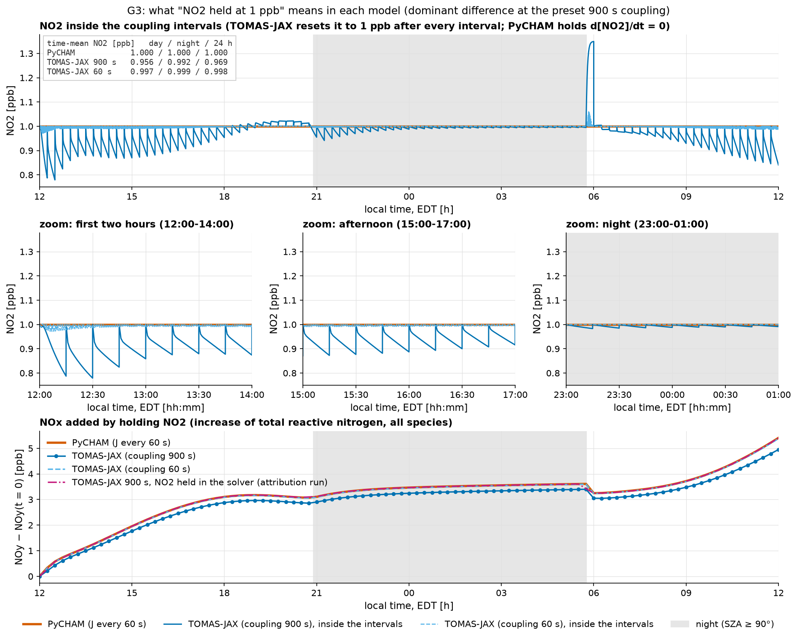
2. *J staircase (numerical).* With J frozen per 900 s interval, the intervals that
   contain sunset and sunrise use the J of their midpoint: 20:45–21:00 still has light
   from 20:52, and 05:45–06:00 gets light 2 min before geometric sunrise. Measured in
   PyCHAM alone (J every 900 s vs 60 s): median \|NMB\| 4e-4 but spikes up to 49 %;
   NO is 28× higher at 21:00, N2O5 +120 % at 06:00 in the 900 s run.
   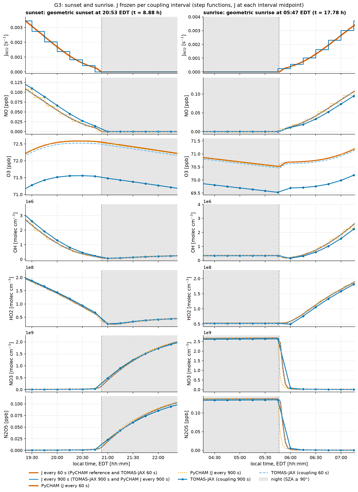
3. *Rates and RO2 frozen for 900 s (numerical).* With J and the hold matched: median
   \|NMB\| 3.9e-4, 93 % of species always within 10 %. The tail is again the RO2+RO2
   products: RO2 is 0 for the first 900 s while 55 % of the limonene reacts, so
   LIMALBOH/LIMAOH/LIMCOH are 54–61 % low (NMB).
4. *Solvers and water vapour.* PyCHAM's own error at default tolerance: median
   2.2e-4, max 5 %. Ours: 2.3e-5.

With all four removed (ours at 60 s, rtol 1e-5, PyCHAM water vapour, NO2 held in the
solver vs PyCHAM at rtol 1e-6) the median \|NMB\| is 1.5e-6 and no species deviates by
more than 0.05 %. Runtime: PyCHAM 37–64 s; TOMAS-JAX 11 s at 900 s, 77 s at 60 s.
More figures: [all species at sunset, midnight, noon](figures/pycham/G3_scatter_all_species.png),
[limonene products and particle-relevant species](figures/pycham/G3_products.png),
[distribution of log10 ratios](figures/pycham/G3_ratio_cdf.png).

---

## Case S1: condensation and evaporation of one surrogate

| Setting | Value |
|---|---|
| Seed | 2000 cm⁻³, GMD 50 nm (placed at 1770 kg m⁻³), GSD 1.6; 70 % sulfate + 30 % non-volatile absorbing organic by mass |
| Surrogate | MW 200 g/mol (PyCHAM 200.23 from its SMILES), produced at 0.5 µg m⁻³ h⁻¹ for 12 h; c* = 1 and 100 µg m⁻³ (at 298 K, corrected to 298.15 K) |
| Environment | 298.15 K, RH 0.5; no chemistry (PyCHAM gets a dummy reaction with k = 0) |
| TOMAS-JAX runs | preset (40 bins); micro-step 10 s; Kelvin off; Kelvin off + PyCHAM's transfer coefficient; 80 and 160 bins |
| PyCHAM runs | preset; update step 10 s + rtol 1e-6; Kelvin off (surface tension 0 in a patched copy); 160 bins |

Built-in checks: initial number and dry mass per bin equal to 1e-9; molar masses,
densities and vapour pressures read back as intended; surrogate mass (gas + particle)
equals production × time to 2e-10 (PyCHAM) and 4e-14 (TOMAS-JAX).

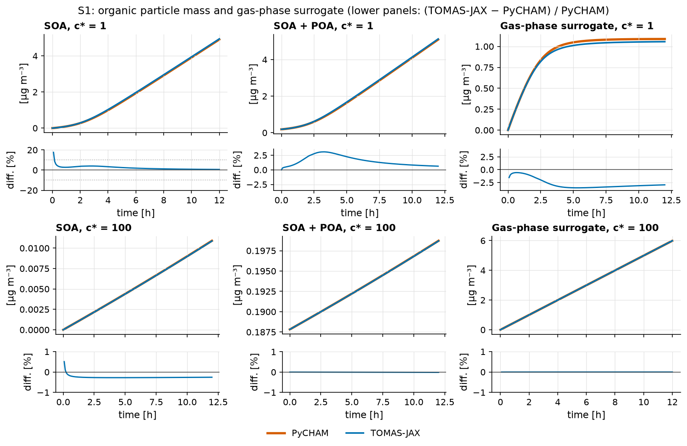

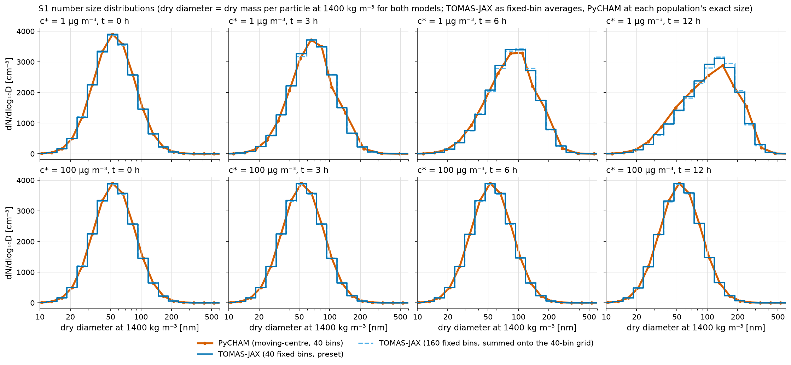

| TOMAS-JAX vs PyCHAM | c* = 1 | c* = 100 |
|---|---|---|
| particle SOA at 12 h | 4.944 vs 4.911 µg m⁻³ (+0.65 %) | 0.01087 vs 0.01090 (−0.26 %) |
| SOA NMB / max deviation after 1 h | +1.3 % / 4.1 % (at 1–3 h) | −0.27 % / 0.28 % |
| gas-phase surrogate at 12 h | 1.056 vs 1.089 µg m⁻³ (−2.9 %) | 5e-6 relative |
| particle water at 12 h (TOMAS-JAX vs PyCHAM) | +10 % | +13 % |
| number-mean dry diameter at 12 h | 123.3 vs 120.5 nm (+2.3 %) | 0.00 % |
| GSD of dry diameter at 12 h | 1.817 vs 1.878 (−3.2 %) | 0.00 % |
| number-mean wet diameter at 12 h | +4.4 % | +2.6 % |

(Dry diameters at 1400 kg m⁻³ in every figure and table, as the tutorial reports.)

**Differences, explained.** 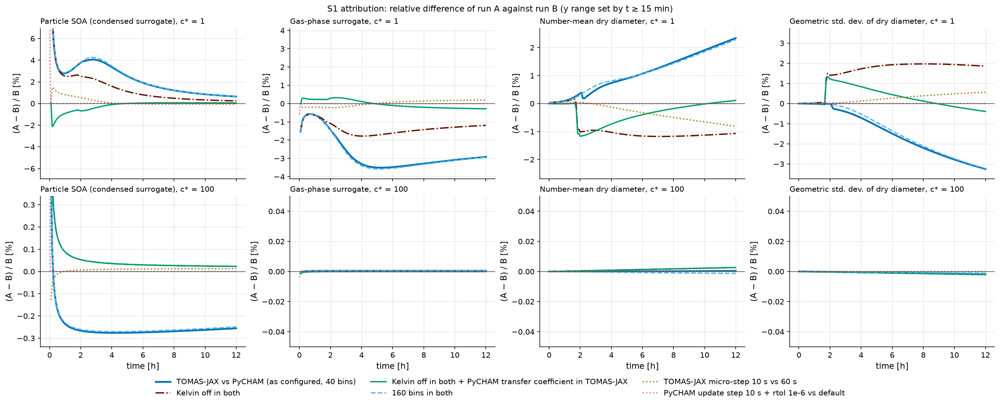
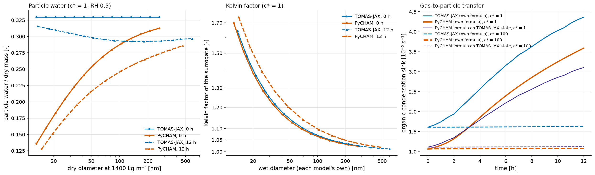

1. *Transfer coefficient (physical formulation).* vbs-jax uses one Fuller diffusion
   volume (120) for every organic, giving D = 7.2e-6 m² s⁻¹ for C10H16O4 against
   PyCHAM's 5.6e-6 (SMILES volume 220). It also combines TOMAS's mean free path 2D/c̄
   with a Fuchs–Sutugin form written for 3D/c̄, so per particle its coefficient is 1.32×
   PyCHAM's at 1 µm, 1.47× at 54 nm and 1.50× at 1 nm, where it is 1.50× the gas-kinetic
   collision rate π r² c̄ N, which no flux should exceed with α = 1. The condensation
   sink at t = 0 is 1.61e-3 vs 1.07e-3 s⁻¹ (1.11e-3 with PyCHAM's formula on our state,
   so the formula and not the particle state is the cause). Effect: c* = 1 SOA runs
   ahead by up to +4.1 % at 1–3 h. With Kelvin off in both it is +2.6 %; with PyCHAM's
   coefficient in TOMAS-JAX as well, −0.9 %.
2. *Kelvin term (physical).* vbs-jax: σ = 0.025 N m⁻¹, ρ = 1200 kg m⁻³, the
   condensing species' MW. PyCHAM: σ = 0.072 N m⁻¹ with the particle's mass-weighted
   mean MW. They nearly coincide at t = 0 (1.145 vs 1.136 at 50 nm wet) but PyCHAM's
   grows as SOA replaces sulfate (1.195 vs 1.145 at 50 nm, 12 h). Kelvin lowers c* = 100
   SOA by 7.0 % (TOMAS-JAX) and 6.7 % (PyCHAM); the −0.26 % gap becomes +0.02 % with
   Kelvin off in both.
3. *Water (physical).* Both give the same bulk water (ezwatereqm: 0.347 kg per kg SO4,
   0.289 per kg organics), but PyCHAM also applies its Kelvin term to water. Total
   water is 13 % lower in PyCHAM at t = 0 (0.179 vs 0.206 µg m⁻³) and 9 % lower at 12 h
   (1.48 vs 1.63); in the most populated bin (the 50 nm seed mode) water/dry is 0.256
   vs 0.330 (−22 %). With Kelvin off in both, water agrees within 0.4 %. Water does not
   absorb organics in either model, so it acts only through particle size.
4. *Size structure (numerical).* TOMAS-JAX changes the particle mass of each bin in
   place and then moves the particles between its fixed bins with a PPM remap in
   log-mass (`AerosolStepConfig.growth_bin_transfer = 'ppm'`,
   [aerosol_step.md](aerosol_step.md#bin-transfer-of-soa-and-nitrate-growth_bin_transfer)):
   each bin's PPM sub-bin profile is carried by the bin's own displacement and
   deposited onto the bins, with a composition slope inside each bin. PyCHAM's
   moving-centre bins keep each population's exact size. Number-mean dry diameter at
   12 h: 123.3 / 123.2 / 123.2 nm at 40 / 80 / 160 bins vs PyCHAM 120.5 nm (120.4 at
   160 bins), GSD 1.817 / 1.816 / 1.815 vs 1.878. The bins are converged at 40, so
   the +2.3 % and −3.2 % that remain are the physics above. With the physics matched
   (Kelvin off in both, PyCHAM's transfer coefficient in TOMAS-JAX) the two models
   agree at every resolution: 138.2 / 137.8 / 137.7 nm at 40 / 80 / 160 bins vs PyCHAM
   138.1 nm (+0.1 / −0.2 / −0.2 %), GSD 1.423 / 1.429 / 1.430 vs 1.428 (−0.4 / +0.05 /
   +0.1 %). With Kelvin off alone: 136.6 vs 138.1 nm (−1.1 %). PyCHAM's stronger
   Kelvin term (item 2) broadens its distribution. SOA mass changes by ≤ 0.02 % with
   resolution. Before 2026-10-15 TOMAS-JAX moved growing particles only with MNFIX
   (part of a bin stays at its centre, the rest jumps to 1/1.1 of the next bin's upper
   edge); over the ×8.9 dry-mass growth this spread the distribution: −12.6 % in
   diameter and +4.8 % in GSD at 40 bins, 105 / 115 / 121 nm at 40 / 80 / 160 bins.
   That scheme is still selectable (`growth_bin_transfer = 'mnfix'`) for comparison.
   (A first PPM version moved particles by flux differences with one displacement per
   bin edge; it gave 122.3 / 122.7 / 123.0 nm and GSD 1.847 / 1.833 / 1.824, i.e. it
   still moved with resolution, and failed for moves of more than about one bin.)
5. *Density (physical).* TOMAS-JAX uses the Tang H2SO4-solution density with organics
   counted as sulfate; PyCHAM adds volumes with water at 1000 kg m⁻³. The dry components
   got an effective 2170 kg m⁻³ so the wet volume matches at t = 0; at 12 h the two rules
   differ by ≤ 0.6 % on the same composition (0.2 % in diameter).
6. *Numerics.* TOMAS-JAX micro-step 10 s vs 60 s: SOA within 0.8 % after 1 h, dry
   diameter −0.8 % at 12 h. PyCHAM update step 10 s and rtol 1e-6: within 0.03 %.

Runtime per 12 h run: TOMAS-JAX 1.3 s (40 bins), 2.9 s (160 bins); PyCHAM 14 s.
More figures: [number-mean diameters and GSD over time](figures/pycham/S1_mean_diameter.png).

---

## Case S2: Level 2 limonene SOA

| Setting | Value |
|---|---|
| Gases, light | as G2 (6 h, constant light, our J prescribed to PyCHAM) |
| Seed | 2000 cm⁻³, GMD 80 nm, GSD 1.6; 70 % sulfate + 30 % non-volatile absorbing organic; PyCHAM gets our bins 4–32 with our per-bin number and dry mass |
| Condensable species | the 245 closed-shell organics with Li et al. (2016) log c* ≤ 4.25 that TOMAS-JAX lumps into 15 half-decade classes; PyCHAM gets each species at the c* of **its TOMAS-JAX class centre** (main run), converted to Pa with PyCHAM's molar mass; everything else is kept out of the particles (checked: 0 µg m⁻³) |
| Water | PyCHAM dissociation constants per component: SA (H2SO4) 0.347 kg water per kg, the seed organic and every condensable 0.289 kg per kg (TOMAS-JAX's ezwatereqm values) |
| Processes | chemistry, H2SO4 condensation, SOA partitioning; coagulation, nucleation, N2O5 uptake off; γ = 0 |
| TOMAS-JAX runs | 300 s (preset), 60 s, 300 s without partitioning; attribution: 60 s with the organic condensation sink × 0.69, then the same with Kelvin off |
| PyCHAM runs | class-centre c* (reference), own Li c* per species, no particles, mass-fraction Raoult, mass-fraction Raoult with Kelvin off, own SMILES-based vapour pressures |

Checks: t = 0 number, dry mass, sulfate and seed organic identical (2000.0 cm⁻³,
2.5644 µg m⁻³); PyCHAM took every vapour pressure (4e-11); without particles the gas
phase agrees as in G2 (median \|NMB\| 1.7e-3, 391 species).

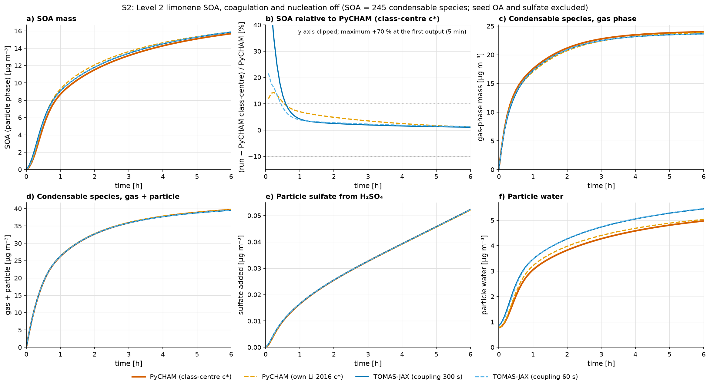

| SOA [µg m⁻³] | 30 min | 1 h | 3 h | 6 h | NMB 0–6 h |
|---|---|---|---|---|---|
| PyCHAM (class-centre c*) | 4.98 | 8.70 | 13.15 | 15.68 | — |
| TOMAS-JAX 300 s | 5.64 (+13.2 %) | 9.06 (+4.2 %) | 13.41 (+1.9 %) | 15.86 (+1.1 %) | +2.4 % |
| TOMAS-JAX 60 s | 5.41 (+8.6 %) | 9.03 (+3.9 %) | 13.45 (+2.3 %) | 15.90 (+1.3 %) | +2.4 % |
| PyCHAM own Li c* (lumping) | 5.52 (+10.7 %) | 9.30 (+7.0 %) | 13.61 (+3.5 %) | 15.87 (+1.2 %) | +3.4 % |

- The chemistry makes the same condensable material: gas + particle mass of the 245
  species is 39.50 (ours) vs 39.69 µg m⁻³ at 6 h (−0.5 %).
- Particle mass per c* class agrees within 11 % for every class above 0.3 µg m⁻³ at
  1, 3 and 6 h. 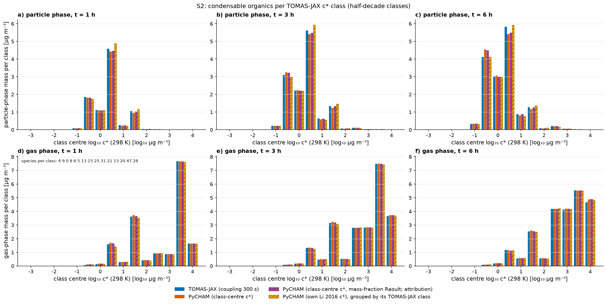
- Sulfate from H2SO4: 0.0523 vs 0.0522 µg m⁻³ at 6 h.
- Particle water: PyCHAM −9 % at t = 0, −12 % at 1 h, −9 % at 6 h (its Kelvin term on
  water; with Kelvin off in both, within 2.5 % at 30 min and 0.6 % afterwards).
- Gas phase with particles present: key oxidants within ~1 % (O3, OH, limonene), NO2
  2 %, NO 4 %; over all 374 species the median \|NMB\| is 4.2 % (300 s), 72 % within
  ±10 %. The spread is in the condensable species themselves (next point).
  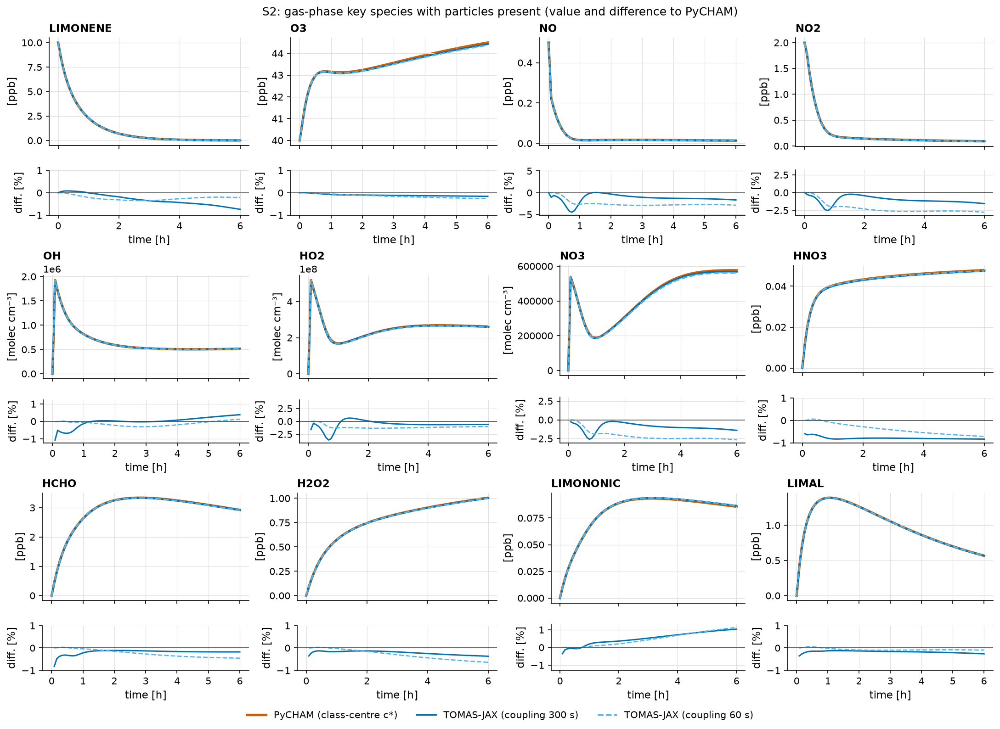

**Attribution of the SOA difference.** 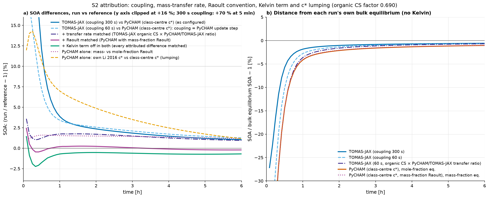

| SOA difference, cumulative steps | 15 min | 30 min | 1 h | 3 h | 6 h |
|---|---|---|---|---|---|
| TOMAS-JAX 300 s vs PyCHAM (as configured) | +34 % | +13 % | +4.2 % | +1.9 % | +1.1 % |
| coupling 60 s (= PyCHAM update step) | +16 % | +8.6 % | +3.9 % | +2.3 % | +1.3 % |
| + transfer rate matched (our organic sink × 0.69) | +2.3 % | +3.1 % | +2.3 % | +1.7 % | +1.1 % |
| + Raoult matched (PyCHAM with mass-fraction Raoult) | +1.0 % | +1.4 % | +0.8 % | +0.3 % | −0.10 % |
| + Kelvin off in both (every attributed difference matched) | −0.77 % | −0.04 % | −0.12 % | −0.38 % | −0.57 % |

1. *Operator split (numerical).* TOMAS-JAX integrates the chemistry over a coupling
   interval and then partitions the vapour formed in that interval over the same
   interval, so new vapour gets the whole interval to condense. 60 s coupling halves the
   early excess.
2. *Transfer rate (physical formulation, as S1).* On the same size distribution
   PyCHAM's organic condensation sink is 0.69× ours (diffusivity alone 0.79×; its own
   diffusion volume of ~200–235 per species against vbs-jax's single 120). Scaling ours
   by 0.69 brings the 30 min excess from +8.6 % to +3.1 %.
3. *Raoult convention (physical).* Mass fraction (ours) vs mole fraction (PyCHAM).
   Converting every c* with one molar mass makes PyCHAM's term a mass-fraction one; this
   alone raises PyCHAM's SOA by 1.2–1.6 %.
4. *Kelvin term (physical).* PyCHAM's Kelvin term is stronger here (it lowers SOA by
   3.8 % at 30 min and 1.3 % at 6 h; ours 2.4 % and 0.8 %), mostly because its σ is 3×
   larger and its particle MW includes sulfate and water.

With the three largest differences matched (coupling, transfer, Raoult) the models agree
within 1.5 % from 10 min on (largest at 25 min); removing the Kelvin term as well leaves
TOMAS-JAX 0.04–0.77 % *below* PyCHAM (largest at 15 min). That residual is the sum of the
differences that were not matched: the transfer factor is one number (0.69) for 245
species whose own ratio varies, PyCHAM's water and density rules, moving-centre vs fixed
bins, the within-class tracker and the seed chemistry (SA is H2SO4, 98 g/mol, in
PyCHAM; SO4/NH4HSO4 in TOMAS-JAX). It stays within 0.8 % from 10 min on.

**Within-class apportionment (TOMAS-JAX design, A6).** TOMAS-JAX partitions classes and
hands the class change to the member species with a tracker. Members of one class have
the same c*, so they should end up with the same particle fraction. PyCHAM gives
0.81–0.83 for the six largest members of class log c* = 0.5 at 6 h; TOMAS-JAX gives
0.29–0.94. Individual "top contributors" are therefore off by up to 4× (C822PAN
4.80 vs 2.95 µg m⁻³, C729PAN 0.61 vs 1.36), their gas phase too, and through their
chemistry ~10 % of mass moves between neighbouring classes. Class totals are robust.
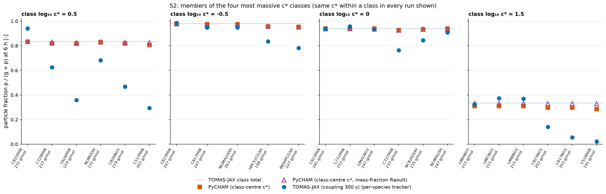
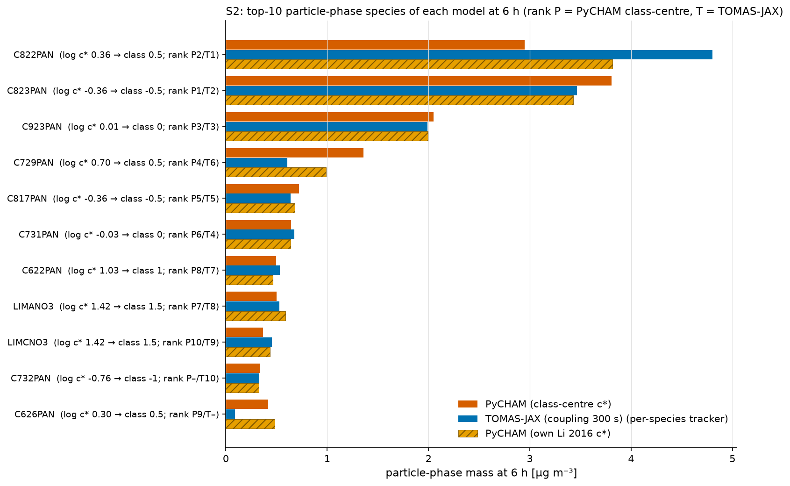

**Size distribution (numerical, as S1).** Number and mass are conserved in both. From
each bin's mean dry size at 6 h (40 bins): number-mean dry diameter 212.3 vs 210.1 nm
(+1.1 %), GSD 1.370 vs 1.411 (−2.9 %), number median 202.6 vs 200.9 nm (+0.8 %),
dry-mass median 266.2 vs 266.8 nm (−0.2 %), dry-mass-weighted mean 280.1 vs 281.7 nm
(−0.6 %). TOMAS-JAX barely moves with resolution: number-mean 212.3 / 211.6 / 211.4 nm,
GSD 1.370 / 1.374 / 1.375, number median 202.6 / 202.7 / 202.4 nm at 40 / 80 / 160
bins. 0.11 / 0.06 / 0.03 % of the particles end below the seed's 1st-percentile
diameter at 40 / 80 / 160 bins (PyCHAM 0.05 %). The medians are read from a mid-rank
cumulative (each bin at its mean dry size, half of its own weight counted below it,
bins without particles skipped); the plain cumulative used before read them about half
a bin low (184 / 193 / 198 nm at 40 / 80 / 160 bins with the first PPM version) and
PyCHAM's empty bins inflated its value (181 nm). These numbers use the PPM bin
transfer for SOA (since 2026-10-15). With the previous MNFIX transfer the distribution
was broader: number-mean 187.4 nm, number median 173.9 nm, GSD 1.85, dry-mass mean 344
nm, and 2.1 % of the particles below the seed size at 40 bins (when SOA evaporates
from small particles MNFIX moves part of a bin down). PyCHAM's moving-centre bins
merge, so its curve is spiky.
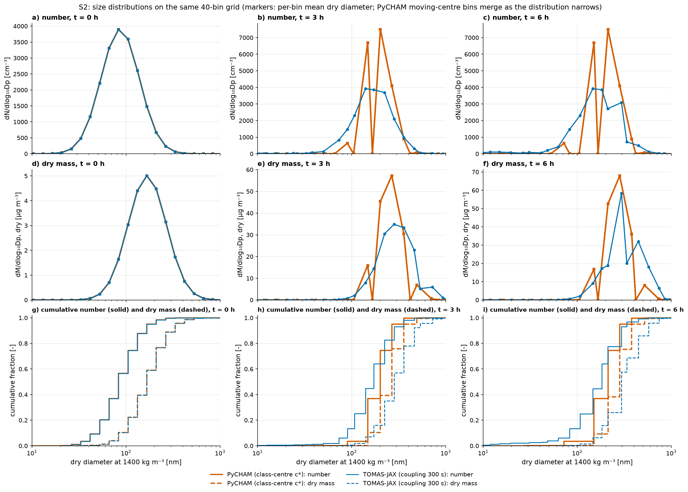

**What S2 does and does not test.** PyCHAM was given our class-centre c* for every
species, so S2 checks partitioning and transport *for identical volatility*. It cannot
confirm or refute the Li et al. (2016) c* (A8). Both models show the same strong
feedback of partitioning on the gas phase (each against its own run without
particles, at 6 h: NO −78 %, NO2 −79 %, OH −35 %, O3 −15 %, limonene +168 %, within 1
point of each other): 98 % of the SOA is N-containing (PAN-type nitrates with Li c* ≈ 1),
holding 0.067 µmol m⁻³ of N, about two thirds of the initial NOx.
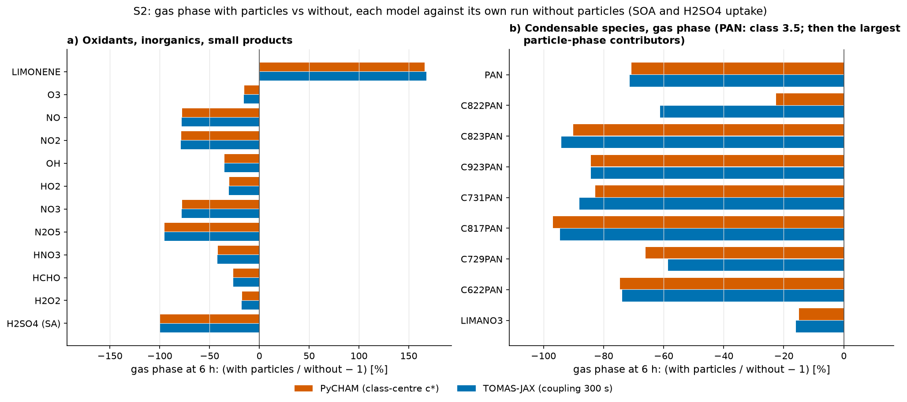

A PyCHAM-only sensitivity run with PyCHAM's own SMILES-based vapour pressures (its
default Nannoolal et al. 2008 method) for the same 245 species shows how much of this
rests on A8: SOA is 0.08× at 1 h and 0.51× at 6 h (7.96 vs 15.68 µg m⁻³), only 5 % of
it is N-containing (hydroperoxides such as LIMALOOH dominate), and the gas-phase
feedback essentially vanishes (NO +1 %, NO2 0 %, OH +6 %, O3 0 %, limonene −4 %).
Neither estimate is "the truth"; the point is that the NOx sink and the yield are
consequences of the volatility table, not of the partitioning code.
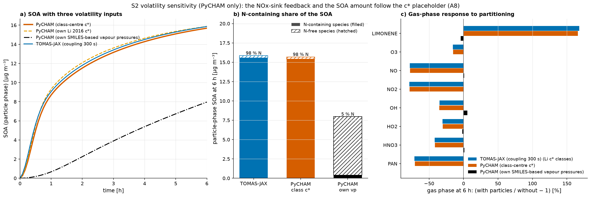

Runtime: PyCHAM ~45 s per 6 h run; TOMAS-JAX 9 s (300 s), 23 s (60 s).
More figures: [all gas-phase species with particles present](figures/pycham/S2_gas_scatter.png).

---

## Verdict per process and what it means for the tutorial

- **Gas chemistry.** Verified: same rate constants, same RO2 pool, same answer to
  solver precision when the numerics are matched. The preset 300 s coupling costs
  ≤ 3 % NMB and only matters in the first 20 min (RO2 = 0 in the first interval). Fine
  for the tutorial as is; a first interval of 60 s, or evaluating RO2 after a short
  spin-up, would remove the start-up artefact.
- **Photolysis and the diurnal cycle.** Verified once J is shared: J from TUV-x, frozen
  at interval midpoints, reproduces PyCHAM when PyCHAM gets the same J. At the Level 3
  preset (900 s) the differences are not small (median 10 %, HNO3 −9 %, nitrates at
  night up to +28 %), and they come from two model choices: NO2 reset after each
  interval instead of held inside the solver, and 900 s intervals (J step at sunset and
  sunrise, RO2 frozen). **Decision needed:** hold NO2 inside the gas solver (a
  prototype is in `benchmarks/pycham/cases/G3/hold.py`), and/or shorten the Level 3
  coupling. ASSUMPTIONS A12 has the coupling sensitivity of the totals (600 s: nitrate
  +3.5 %, SOA +2.4 %; 300 s: +6.6 %, +4.7 %, re-measured 2026-10-16).
- **Condensation / evaporation.** Mass partitioning is right (≤ 0.7 % at 12 h,
  equilibrium within 0.03 % with Kelvin off). The approach to equilibrium is faster than
  PyCHAM's because the vbs-jax transfer coefficient is up to 1.5× larger and exceeds the
  kinetic limit for small particles; this shows as +3–4 % SOA at 1–3 h (S1) and part of
  the +13 % at 30 min (S2). **Decision needed:** use mfp = 3D/c̄ with the Zaveri
  Fuchs–Sutugin form (or 2D/c̄ with a matching form) and a per-class diffusion volume.
  The size distribution used to spread at 40 bins (mean diameter −13 % after a ×9 mass
  growth; converged only at 160 bins). Fixed 2026-10-15: SOA growth now uses a PPM
  remap; the 40-bin mean diameter is within 0.1 % (S1) and 0.4 % (S2) of the 160-bin
  run. The +2.3 % in mean diameter and −3.2 % in GSD that remain against PyCHAM in S1
  are the Kelvin term and transfer coefficient: with both matched the models agree
  within 0.2 % and 0.4 % at 40, 80 and 160 bins.
- **SOA partitioning with chemistry.** Class totals agree (≤ 11 %), total SOA within
  1–4.2 % after 1 h. Per-species "top contributors" from the tracker are not reliable
  within a class (up to 4×); the tutorial should present class totals, or the tracker
  should share condensation and evaporation so that members keep one particle
  fraction. The volatility input (A8) dominates the SOA amount and the NOx-sink feedback
  far more than any numerical difference found here.

## Findings about TOMAS-JAX (reported, not changed)

1. Level 3 NO2 hold is a reset per coupling interval (G3): ~8 % less NOx supplied at
   900 s, median species difference 10 % against a continuous hold.
2. RO2 = 0 during the first coupling interval (G2, G3): RO2+RO2 products 50–60 % low
   in the first 900 s of Level 3.
3. vbs-jax transfer coefficient exceeds the kinetic limit by up to 1.5× and uses one
   diffusion volume (120) for every organic (S1, S2).
4. *Fixed 2026-10-15.* MNFIX-only growth across bins spread the size distribution at
   40 bins and put ~2 % of the particles below the seed size (S1, S2). SOA and nitrate
   now move between bins with a PPM remap; S1 and S2 above show the new numbers (the old
   scheme stays selectable as `growth_bin_transfer = 'mnfix'`).
5. The within-class species tracker (`ClassBridge.scatter`) gives members of one class
   different particle fractions (S2).
6. `driver.run` never passes `AerosolStepConfig.micro_dt` to `aerosol_outer_step`; the
   step always uses its default of 60 s (no effect today, but a config change would be
   ignored silently) (S1).
7. Particle water has no Kelvin term (A9): for 50 nm particles it is 22 % above an
   ideal solution with Kelvin (S1).

## PyCHAM findings worth reporting upstream

- **Photolysis table differs from MCM v3.3.1.** PyCHAM's built-in MCM J
  (`photolysisRates.py`) has J18/J19 (MACR) = 1.140e-5 and J23/J24 (MVK) = 1.836e-5
  where the MCM v3.3.1 KPP export (`constants_mcm.f90`) has 1.482e-6 and 2.424e-6
  (×7.7, ×7.6), J56 (NOA) = 7.549e-6 cos^1.015 exp(−0.324 sec) vs
  4.365e-5 cos^1.089 exp(−0.323 sec), and **no J20** (C5HPALD1, 7.6e-4 cos^0.396
  exp(−0.298 sec)), which is therefore silently zero. A patch with the v3.3.1 values is
  kept in `benchmarks/pycham/patches/mcm331_kpp_photolysis.patch` (not applied here).
- **Silent zero photolysis.** MCM photolysis is switched on only when
  `photo_path == cwd + '/PyCHAM/photofiles/MCMv3.2'`; started from any other working
  directory PyCHAM runs with J = 0 and no warning.
- **Single seed component crash.** With one seed component, `pp_water_equil.py`
  squeezes the mole-fraction array to a scalar and indexing fails; fixed by
  `np.atleast_1d` (`patches/single_seed_dry_fix.patch`).
- **`dens` units.** `dens`/`dens_Comp` are used in kg m⁻³ although the README says
  g cm⁻³; g cm⁻³ input gives ~2 kg m⁻³ particles, an overflowing Kelvin term and a
  "Factor is exactly singular" crash in the water solver. A `dens_Comp` entry for H2O is
  ignored silently.
- **Number files.** `particle_number_concentration_dry` re-bins particles by dry
  volume against the wet bin bounds and does not line up with the per-bin composition;
  `size_bin_radius` at t = 0 is the dry input radius when `Vwat_inc = 0`.
- **Fixed surface tension.** `surfT = 72` mN m⁻¹ is hard-coded and also applied to
  water uptake; there is no input to change it.
- **Other.** An inert dry seed with no absorbing mass at t = 0 stalls the solver; one
  simulation per checkout at a time (PyCHAM rewrites `rate_coeffs.py`, `ode_solv.py`
  and `pickle.pkl` in place); `p_init` defaults to 9.8e4 Pa.

## Limitations

- **Untested processes.** Coagulation (on in all three presets), nucleation (off in
  the presets too), N2O5 uptake (Level 3, γ = 0.02) and the Level 3 aerosol were
  switched off in every case. A coagulation-only seed case (PyCHAM `coag_on = 1`) is
  the obvious next step.
- **Volatility is not tested.** S2 gives PyCHAM our c*; it checks the partitioning
  code, not the Li et al. (2016) estimate (A8). The native-vapour-pressure run is a
  sensitivity, not a validation.
- **One condition per case.** One temperature (293–298 K), one RH, one seed; no
  temperature dependence of c* was exercised (PyCHAM's `volP` is constant in T).
- **Water and density are matched only in bulk.** PyCHAM keeps its Kelvin term on
  water and its additive density; both are recorded and quantified above.
- **PyCHAM is a reference, not ground truth.** Where the two differ for physical
  reasons (Raoult convention, Kelvin term, transfer formula) neither is "right"; the
  attribution shows which choice causes what.

## How to reproduce

```bash
cd tomas-jax
.venv/bin/python -m benchmarks.pycham.run_all                 # all cases and figures, ~35 min
.venv/bin/python -m benchmarks.pycham.run_all --analyse-only  # figures and tables from saved results
```

The PyCHAM install (pinned commit, patch, venv) is described in
`benchmarks/pycham/README.md`. Every model run has a wall-clock limit, every case
checks its own set-up and raises on failure, and the small results (≤ 2.4 MB per case)
are in `benchmarks/pycham/cases/<case>/results/`. All settings live in
`benchmarks/pycham/config.py`.
